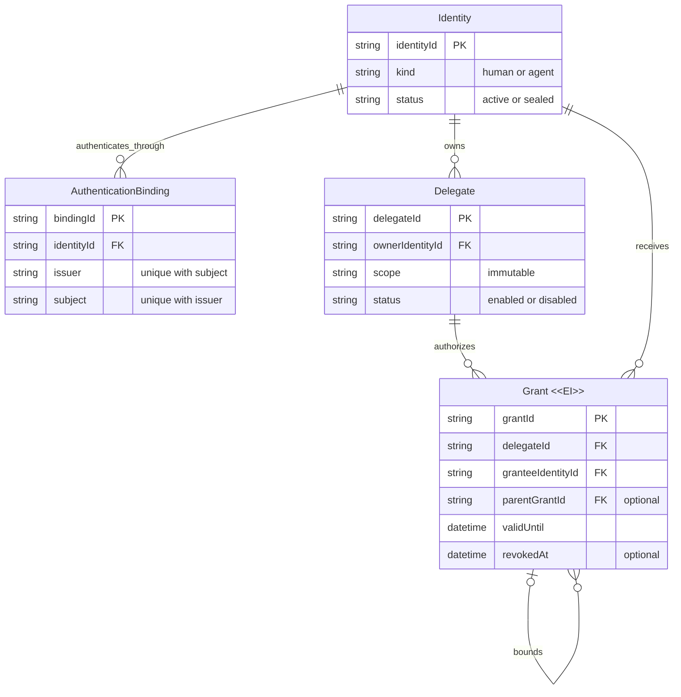
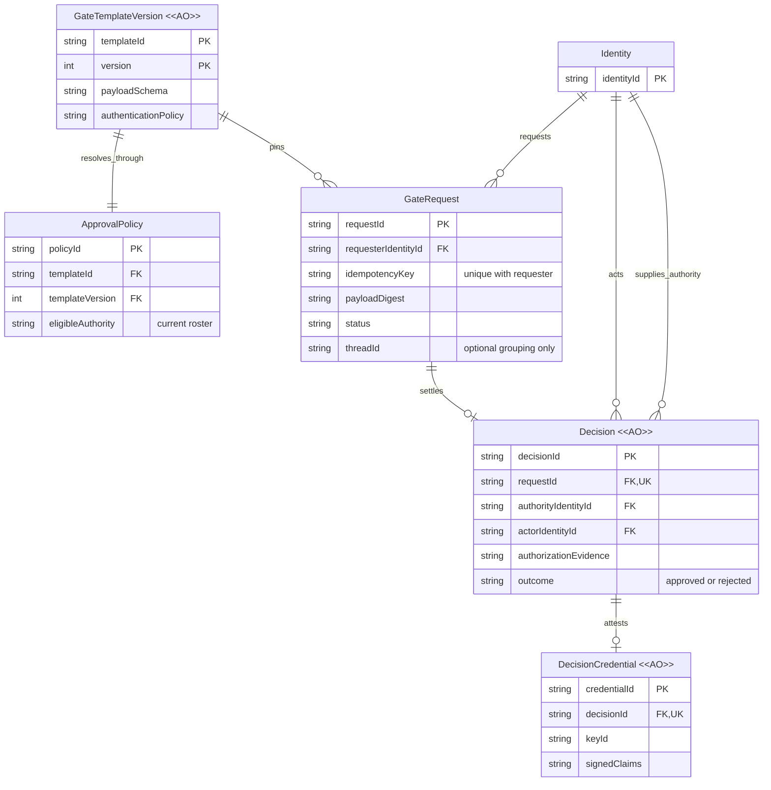

# 业务模型设计

## 设计决定

- Gate 是“对固定业务载荷作出可验证决定”的服务，不是任务执行器或通用流程引擎。
- 人类与 Agent 都是 Identity；实际操作者、权限主体、委托范围与限时授权分开建模。
- 请求、决定和凭证分离：先产生唯一不可变决定，再可靠地签发证据；批准不等于凭证已经可用。

本文是 [Idea.md](Idea.md)
的设计依据，不以现有实现为约束，也不描述迁移方案。实体、关系和规则均为拟议产品模型。

## 主要取舍及原因

| 选择                                    | 不采用的替代方案                 | 原因                                       |
| --------------------------------------- | -------------------------------- | ------------------------------------------ |
| 一个请求固定一个模板版本与一个载荷快照  | 审批过程中编辑载荷或自动升级模板 | 审批人、调用方与凭证必须指向同一件事       |
| 当前审批资格在提交时解析                | 冻结创建时的审批名单             | 已失效的权限不能继续审批                   |
| 首个合格批准或拒绝生效                  | 多人会签、顺序审批、投票         | 先把单决策网关做正确，复杂流程由调用方编排 |
| Delegate 描述权限，Grant 将权限授予身份 | 创建 Agent 就继承创建者权限      | 责任来源不是权限来源                       |
| Thread 只分组历史                       | Thread 成为 ACL 或权限容器       | 避免持有定位符就取得载荷或审批权限         |

## 实体关系

两个视图中的 Identity 是同一实体；图中键只表达业务唯一性与关联，不是物理表设计。

### 谁凭什么权限行动

Identity 的 kind 与 ID 固定，身份停用后封存，不复用。外部登录凭据按
`(issuer, subject)`
唯一映射；不能按邮箱自动合并身份。Agent 使用独立认证绑定，不借用创建者的浏览器会话。

Delegate 的 scope 是可机器验证的范围：操作类型（创建/决定/查看载荷等）、模板或资源选择范围及可否转委托。范围与所有者固定；改范围创建新 Delegate。Grant 固定接收身份、有效期和上游引用，撤销只能向前生效。第一版关闭转委托；保留 parentGrant 以定义未来扩展，而不把它当作首版能力。

### 什么被决定，什么成为历史证据

模板版本固定业务 schema、展示说明、认证强度和资格解析方式；ApprovalPolicy 保存可调整的当前审批资格。更新名单要留审计，但不改模板版本。身份、Delegate/Grant、名单与认证策略共同决定是否有权行动。

AuditEvent 是横跨身份、权限和请求的只追加记录，不为了画图把它复制成多个业务实体。事件至少记录 subject、动作、actor、authority、相关授权引用和时间；决定还需冻结足以解释当时授权检查的证据快照，不只是一个以后会变化的 Grant
ID。

## 生命周期

| 实体                             | 可以改变什么                                    | 有效性如何结束                                    | 删除/保留规则                                                 |
| -------------------------------- | ----------------------------------------------- | ------------------------------------------------- | ------------------------------------------------------------- |
| Identity / AuthenticationBinding | 启用状态、认证绑定；Identity ID/kind 固定       | 停用身份或绑定                                    | 保留历史身份和绑定归属，不能重新分配历史 subject              |
| Delegate                         | 仅启用状态；范围与所有者固定                    | 停用，或所有者不再有可委托权限                    | 新范围用新实体，旧引用保留                                    |
| Grant `<<EI>>`                   | 仅不可逆撤销标记；绑定、有效期固定              | 到期、撤销、身份或上游权限失效                    | 延长有效期签发新 Grant；不删除历史授权                        |
| TemplateVersion `<<AO>>`         | 版本内容不变；模板逻辑可有独立停用入口          | 停用禁止新请求，既有请求仍固定版本                | 新内容产生新版本；保留旧版本                                  |
| ApprovalPolicy                   | 当前合格权限主体名单                            | 成员移除即失去未来资格                            | 每次变化与审计原子提交                                        |
| GateRequest                      | 仅 pending 一次转为 approved/rejected/withdrawn | 不设超时；三个终态不可重开                        | 载荷、版本、请求方与归组键固定，不删除历史                    |
| Decision / Credential `<<AO>>`   | 不修改；签发任务状态在独立操作记录中            | 撤销权限不重写历史；泄露密钥使该 keyId 凭证不可信 | 重试不能产生不同决定或覆盖凭证，纠错用补偿事件                |
| AuditEvent `<<AO>>`              | 不修改、不删除                                  | 不适用                                            | 首版长期保留；清理/个人信息政策需另行明确，不默认具备删除接口 |

撤回由请求方完成，只产生终态和审计，不产生审批 Decision 或可放行凭证。认证会话、Agent
token 是可过期的认证材料，不是业务权限；Thread、GateURI、工作台待办和缓存也不是新的授权实体。

## 七条核心不变量

1. **操作者不能自报。**
   服务端从认证绑定解析 actor；直接操作时 authority=actor，委托操作时明确记录 authority、Delegate、Grant 和证据。创建身份不授予业务权限。
2. **权限分项检查。**
   创建请求、查看载荷、批准/拒绝、管理模板、授予权限不是同一权限。管理员不自动成为合格审批人，持有链接不授予权限。
3. **创建严格幂等。** `(requesterIdentityId, idempotencyKey)`
   唯一；内容相同返回原请求，内容不同返回冲突。拒绝/撤回后必须用新键创建新请求。
4. **载荷与版本固定。** 创建时依据模板 JSON
   Schema 验证完整 JSON 载荷；摘要固定为 SHA-256 的 RFC 8785 JCS
   `{payload,schemaVersion}` 封装。展示摘要不代替实际载荷核对。
5. **提交时验证且原子决策。**
   pending、资格、认证强度、Grant 有效性与撤销状态在同一受保护事务中判断；状态、Decision、授权证据、审计和签发任务原子提交。请求方撤回也竞争同一终态。
6. **凭证不创造新决定。**
   签发基于冻结的 Decision；失败可恢复，请求不回退。调用方只在 outcome=approved、签名有效且预期载荷摘要匹配时放行；有效的拒绝签名仍不放行。
7. **信任快照显式。**
   签名密钥轮换生成新 keyId；确认泄露则所有该 keyId 的凭证不可信。离线验证返回 trust-bundle 版本与密钥状态，不声称旧快照代表当前事实；快照新鲜度由调用方策略明确。

## 边界与默认决定

- 第一版服务单一信任域，不增加组织/租户实体；跨组织隔离需另立产品需求，不能靠 Thread 模拟。
- 人类认证应支持模板要求的 step-up/MFA；Agent 只用自身短期认证令牌，令牌不携带永久审批权。
- 代理登录账户绑定需重新认证并验证所有权；不按同名、邮箱或创建关系猜测归属。
- 初版不做会签、投票、超时批准、批量决定和转委托；通知与回调以后增加，不改变审批事实。
- 载荷长期保留且逐请求授权；实际保留期限、删除合规性、MFA 保证等级和密钥保管责任需要业务/运维确认。

## 设计校验

2026-10-14：两段 Mermaid 已在本地浏览器渲染并目视检查关系、基数和 `<<AO>>` /
`<<EI>>`
标签；图与生命周期表交叉核对。本轮是目标设计审阅，没有执行数据库迁移或证明授权实现已完成。

是否同意这个身份、权限、请求、决定与凭证相互分离的业务模型？
