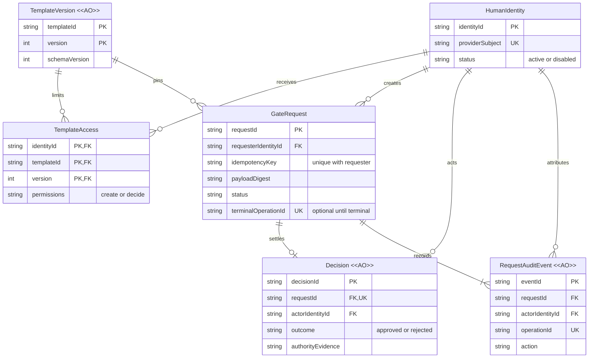

# MVP 1 业务模型：直接人类审批

## 本次设计决定

- 一个受限信任域、一个预置模板、两个独立人类身份形成闭环，不建立 Agent、委托或凭证实体。
- 请求创建后冻结内容；审批与撤回竞争同一终态，成功时同时留下不可改写的证据。
- 第三方登录只是身份来源，业务创建/读取/决定权限由 Gate 显式配置，不由邮箱、管理员身份或登录成功推导。

本文件支撑 [Idea.md](Idea.md)，只细化已接受的 MVP
1 范围，不是现有数据库说明或已完成实现。页面、API 与写入约定见
[详细设计](Design.md)。

## 主要取舍

| 范围基线               | 细化选择                                                               | 理由                                                |
| ---------------------- | ---------------------------------------------------------------------- | --------------------------------------------------- |
| 一个登录提供商         | 首版 GitHub OAuth；以 provider 的稳定 subject 绑定 Gate Identity       | 两个真实测试账号易于试点；显示名称/邮箱不作为授权键 |
| 一个业务 schema 的模板 | 预置 `release-review` v1，仅测试发布用途；内容不可变，资格名单独立可变 | 不先开发模板编辑后台，但不牺牲版本与名单撤销语义    |
| 请求方与另一审批人     | 禁止自己审批自己的请求                                                 | 保证双人闭环，不把登录演示当成审批分离              |
| 在线结果与历史         | 固定 Decision 与请求审计，不签名                                       | MVP 3 可扩展签发，但本轮不提前创建 outbox 或伪凭证  |

## 目标关系

TemplateAccess 代表直接权限，创建与决定权限分别配置；一个身份可同时有两种权限，但仍禁止审批自己的请求。管理资格的运维身份不是图中的超级审批人。身份启停、名单调整还需单独的只追加配置审计，不能误写成某个请求的生命周期事件。

## 生命周期与规则

| 实体                       | 可改变内容                                               | 结束或失效方式                                | 历史规则                                              |
| -------------------------- | -------------------------------------------------------- | --------------------------------------------- | ----------------------------------------------------- |
| HumanIdentity              | 展示信息、启用状态；Gate ID 与 provider subject 归属固定 | 停用立即阻止未来访问/写入                     | 不删除被引用的身份，不重用 ID，不按邮箱合并           |
| TemplateVersion `<<AO>>`   | 内容不可变                                               | 入口可停用以阻止新请求；旧 pending 不自动撤回 | 变更内容发布新版本，历史保留                          |
| TemplateAccess             | 当前创建/决定资格                                        | 移除资格后未来对应操作被拒绝                  | 配置变化与运维审计原子记录，不改历史决定              |
| GateRequest                | 只允许 pending 一次转为 approved/rejected/withdrawn      | 无审批超时，终态不可重开                      | 载荷、摘要、请求方、幂等键、版本、Thread 固定，不删除 |
| Decision `<<AO>>`          | 不变，actor=authority                                    | 之后名单撤销不否定当时决定                    | 一请求至多一个 Decision，撤回没有 Decision            |
| RequestAuditEvent `<<AO>>` | 不变                                                     | 不适用                                        | 创建必有事件，终态必有一个事件；常规操作不能更新/删除 |

身份绑定与请求历史在本轮长期保留；不提供删除、审计修正或全库导出。运维审计不需要开放一个全功能后台。

## 七条不变量

1. 服务端从登录会话解析稳定 Gate
   Identity；匿名、未获准或停用身份不能操作。provider
   subject 绑定只通过明确且经验证的配置建立，客户端不能自报 actor。
2. 创建须有该模板版本的 create 权限；决定须有当前 decide 权限且 actor≠requester。读取只允许 active
   requester 或该固定模板版本的 active 当前合格审批人。
3. 创建键为
   `(requesterIdentityId, idempotencyKey)`；固定业务内容指纹相同返回同一个请求，内容不同为冲突。历史重放也须当前有读取该请求的权限，不绕过停用。
4. 创建时执行业务 schema 校验，固定 `templateId/version/schemaVersion`
   与完整载荷。摘要是
   `sha256(JCS({payload,schemaVersion}))`；表单标题、显示名称和 Thread 不替代摘要。
5. 每次终态写入在数据库原子路径中重新检查 active 身份、当前名单、会话有效性与 pending；和撤回同一竞争顺序。只有本次 operationId 赢得状态更新，才可写 Decision/终态事件。
6. 状态与证据同一个 D1
   batch 全成功或全回滚。Decision 保存实际 actor、直接 authority、资格/身份修订证据及数据库确定的决定时间；历史证据不依赖后来会改变的名字或名单。
7. 在线 `approved`
   只说明 Gate 的结果，不证明实际发布已经发生；不提供签名、离线或模板 MFA 保证，拒绝/撤回不得恢复业务。

## 兼容与审阅边界

已有原型只按符合此契约的能力复用；不能假设其 OAuth session user
ID 就是完整 Gate 绑定，或 SQLite 适配器已证明真实 D1 并发。若试点已有请求，迁移前明确 ID/subject/版本/摘要映射，不猜测邮箱、不覆盖历史、不补造决定或审计。新 direct
Decision 的 actor=authority，未来委托扩展不得改写这一事实。

需要部署前确认的是 GitHub OAuth
App 归属、两位试点参与者的稳定 subject、运维负责人和非敏感测试环境；这些是配置/外部条件，不是授权默认值。

## 设计校验

2026-10-14：业务 ER 图已在本地 Mermaid 浏览器渲染，目视核对实体、关系基数和
`<<AO>>`
标签；设计内相对链接有效，Implementation/Deployment 与 ledger 的稳定 ID 和标题匹配。此为文档与图示校验，未验证业务实现、D1 并发或真实认证。

是否同意这个仅直接人类权限、禁止自审批、原子终态与可追溯历史的 MVP 1 业务模型？
