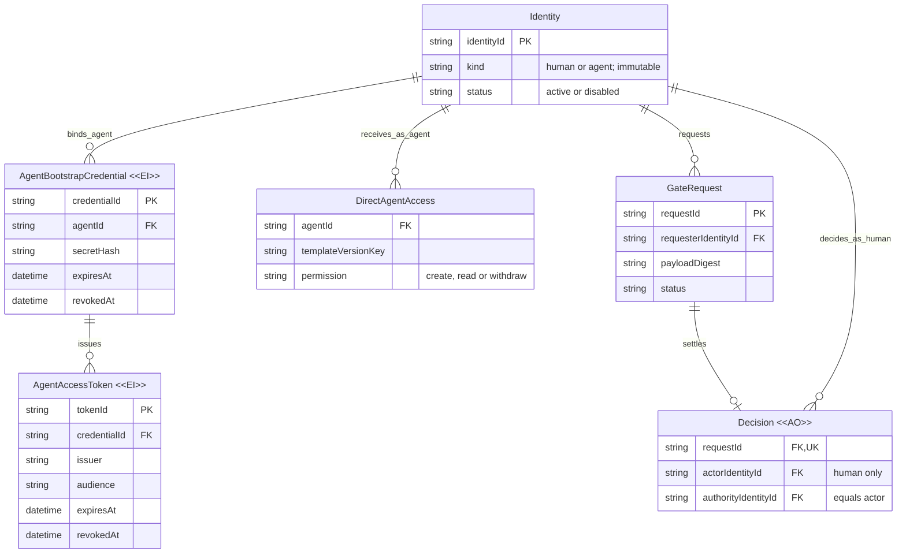

# MVP 2 详细设计：独立 Agent、在线确认、失败不放行

## 本轮待审决定与边界

1. 采用**稳定 Agent 身份 + 独立随机 bootstrap credential + 5 分钟 opaque
   token**，由 Gate 的 D1 在线验证；不引入 federation、JWT 签名基础设施或离线信任。
2. 人类仍使用 MVP 1 的 Auth.js
   cookie；Agent 使用独立机器路由，只获显式的 create/read/withdraw 权限，永远不能 approve/reject。
3. 批准本设计后可并行做**本地实现、迁移和运行时验证**。MVP
   1 的外部 OAuth、云端受限双人试点及对应验收仍是 MVP 2
   **真实试点部署与现实世界验收**的前置条件；本设计不授权云资源写入、部署、凭据读取或生命周期事件变更。

本文是 [Idea.md](Idea.md)
的设计依据；目前仅为设计候选，没有实现、外部验收或新生命周期决定。复用最终模型的 Identity、直接权限和唯一终态，不把当前物理表限制固化为产品能力。

## 当前 → 提议 → 原因

| 当前实际实现                                                                      | MVP 2 增量                                                                   | 原因                                                    |
| --------------------------------------------------------------------------------- | ---------------------------------------------------------------------------- | ------------------------------------------------------- |
| `auth.ts` 只认可 Auth.js HttpOnly cookie；`gate_identities` 必须有 GitHub subject | 保留人类路径，增加机器认证与稳定 Agent 注册表                                | 不伪造 GitHub subject，不让机器借用人类会话             |
| `gate-store.ts` 用会话条件保护载荷读取、条件写入和审计；人类请求方可读/撤回       | 增加独立机器 principal；机器每次操作检查 token、credential、身份及直接权限   | 创建关系、认证成功均不等于业务授权                      |
| `gate_template_access` 只有 human create/decide                                   | Agent 权限表独立限定 create/read/withdraw，逐模板版本且限本人请求            | 保留人类兼容性，避免重建已有权限表或误授审批            |
| 前端详情仅显示请求方稳定 ID                                                       | 列表、详情显示服务端确定的“人类 / Agent / 历史来源未绑定”，仍显示完整稳定 ID | 不把 Agent 当成审批人，不将旧未映射身份伪造成已认证人类 |

### 目标业务关系

下图 Identity 是同一逻辑实体；不要求人类和 Agent 在本阶段共用物理表。Token 是需要审阅有效期/撤销语义的认证记录，不是业务授权或离线凭证。



| 实体                       | 可变化内容 / 有效性结束                                                                    | 保留规则                                                         |
| -------------------------- | ------------------------------------------------------------------------------------------ | ---------------------------------------------------------------- |
| Identity                   | ID、kind 固定；名称/启用状态变更要递增 revision；停用或凭据整体失效时递增 token generation | 不删除、不复用 ID；重新启用不复活旧 token；创建来源不授予权限    |
| Bootstrap `<<EI>>`         | agent、hash、到期时间固定；仅允许不可逆撤销；到期或身份停用即不可用                        | 轮换生成新 credential；旧记录保留，撤销使其已签发 token 同时无效 |
| Token `<<EI>>`             | 绑定、hash、issuer/audience、generation、签发/到期时间固定；仅允许不可逆撤销               | 不延期、不刷新；重新交换生成新 token，本阶段不提供清理历史接口   |
| DirectAgentAccess          | 受控运维显式分项授予/移除，变化与配置审计原子提交                                          | 删除即影响下次操作，不缓存旧权限；重新授予需更高 revision        |
| Request；Decision `<<AO>>` | 请求固定快照，仅 pending 一次转终态；Decision 只追加                                       | 不修改旧载荷、actor/authority、摘要、事件或决定，不补造历史证明  |

## 身份、凭据与 token

- 运维以受控本地工具注册 Agent、责任归属及权限；不提供公共注册或 Agent 自助提权接口。注册者不是 Agent 的 authority。后续真实环境的交付流程须另经外部门禁。
- credential 使用 CSPRNG 生成至少 32 字节秘密，带独立公开
  `credentialId`；D1 只保存带类型/ID 域分隔的 SHA-256
  hash。随机高熵秘密不是用户口令，不接受用户自选低熵密码。校验采用运行时支持的常量时间字节比较，不直接比较 secret 字符串。
- credential 默认有效 30 天，可提前撤销；本地交付写入操作者指定的仓库内 gitignored 文件，独占创建、不覆盖，限制文件访问。不把秘密写入 stdout、命令参数、URL、数据库审计或错误响应；示例只从文件读取。不读取现有
  `.dev.vars` 或任何真实凭据。
- `POST /api/agent/token` 接受有界 JSON
  `{credentialId, credentialSecret}`，忽略/拒绝额外字段，不接受 cookie 或人类会话。成功返回
  `{accessToken, tokenType: "Bearer", expiresIn: 300, issuer, audience, identityId}`；设置
  `Cache-Control: no-store`，不签发 refresh token。
- token 为
  `gat_<publicTokenId>.<32-byte-base64url-secret>`，D1 只保存域分隔 hash，关联 credential、Agent、generation、`issued_at`、`expires_at`、`revoked_at`。交换的条件 INSERT 同时验证 credential/Agent 当前有效性，避免校验后撤销仍签发有效 token。
- issuer 来自可信部署配置
  `GATE_AGENT_ISSUER`，**不从 Host、转发头或请求 body 推导**；audience 固定
  `urn:silvermoon-gate:agent-api`。本地 issuer 使用
  `urn:silvermoon-gate:local`，真实试点必须使用不同 issuer 与独立 D1。缺少 issuer 时机器认证失败关闭，不影响人类登录。
- opaque
  token 的 issuer/audience/有效期在服务端行中，不是客户端可篡改的 claims。每次读取载荷、创建或撤回均在参数化 SQL 条件中重新校验：hash 匹配、issuer/audience 精确匹配、`issued_at <= DB now < expires_at`、寿命不超过 300 秒、token/credential 未撤销、credential 未到期、身份 active、generation 相符。D1 不可用即失败，不回退缓存。
- 单 token 撤销、credential 撤销、身份停用和权限移除分别有本地操作与测试；失败消息不区分不存在/过期/撤销 credential，避免认证枚举。端点记录必要的 traceId/固定错误码，不记录认证 body、Authorization、cookie、hash 或完整请求/响应。限制输入体积和超时，不增加暗中重试。

## 路由与权限矩阵

| 路由                                    | 身份与检查                                              | 结果                                                                                    |
| --------------------------------------- | ------------------------------------------------------- | --------------------------------------------------------------------------------------- |
| `POST /api/agent/token`                 | 有效 bootstrap；不接受 Bearer 或 cookie                 | 短期 token；失败 401，不泄漏存在性                                                      |
| `POST /api/agent/requests`              | 有效 Agent token；模板 enabled；显式 create **与 read** | 复用固定 release-review v1 envelope、16 KiB 上限、`Idempotency-Key` 和 201/200 replayed |
| `GET /api/agent/requests/:id`           | 有效 token；显式 read；requester 必须是本人             | 在线详情/历史；无权或不存在统一 404                                                     |
| `POST /api/agent/requests/:id/withdraw` | 有效 token；本人；显式 read+withdraw；pending           | 唯一撤回终态与 created/withdrawn 实际 Agent actor                                       |
| 任何机器 decision/inbox 路径            | 不提供；无能力映射为人类审批                            | 不允许 Agent approve/reject，即使错误配置了人类 decide 行                               |
| 原 `/api/*` 人类接口及 `/api/auth/*`    | 原 cookie、当前会话和人类权限；Bearer 不成为会话        | 原 Origin/CSRF、无自审批、重定向、登出撤销行为保持                                      |

机器路由单独挂载，只有验证成功的机器 principal 才能调用机器存储操作；不是“有 Authorization 就跳过 Origin”。机器路由拒绝 Cookie、Origin 和 cross-site
fetch 请求，不启用 CORS；token 只能经显式 Authorization
Bearer 传入业务路由。浏览器登录、创建、决定、撤回依旧严格要求原 same-origin 检查，不能通过拼入 Bearer 降级。

Agent 权限键为
`(agentId, templateId, templateVersion, permission)`。read/withdraw 仅覆盖该 Agent 自己发起的请求，不能凭模板权限、requestId、Thread 或注册者关系读取他人的载荷。模板入口停用只禁止新建；对既有请求的读取/撤回仍按当前独立权限检查。权限撤销不会重写已发生的终态。

**存储不变量：**

1. Principal 从认证解析，客户端不得提交 requester/actor/authority；Agent 和 human 分支在共享 store 中显式区分，不能伪装 human
   session。
2. 参数值全部
   `.bind(...)`；SQL 结构仅由受信代码选择。载荷 SELECT、条件 INSERT/UPDATE 均包含对应认证、身份、权限条件，不只在 middleware 检查。
3. 继续使用 `(requester_identity_id, idempotency_key)`
   唯一约束与现有 fingerprint；相同 key+内容返回同一请求，内容变化为 409。token 轮换不改变 requester 或幂等作用域。
4. 撤回/人类批准/拒绝竞争继续以 pending 条件 CAS 和唯一 operationId 判赢家，终态、Decision、事件原子提交；证据写入失败整体回滚，失败者不能写历史。
5. 人类决定必须 kind=human、当前会话及直接 decide 有效且
   `actor != requester`；`authority=actor`。任何 Agent 路径均不产生 Decision。UI 的 allowedActions 同样来源于服务端规则，不构成授权。
6. `payloadDigest` 继续是共享合约
   `calculatePayloadDigest(schemaVersion,payload)`
   的结果，包含 schemaVersion；不是
   `artifactDigest`，也不是对响应内容另造一种 hash。

## 迁移与兼容性

新增
`0003_agent_mvp.sql`，不改写已发布的 0001/0002；新增表与约束如下。**避免重建现有人类父表及其外键/触发器**，不需要关闭 foreign
keys：

- `gate_agent_identities`：稳定 ID、名称、status、revision、token_generation、注册责任归属；与现有人类表共同投影逻辑 Identity。Agent
  ID 建议带 `agent:`
  前缀，但唯一性不能只靠前缀：两张表的 INSERT 触发器均阻止跨表同 ID；Agent 注册还禁止占用任何既有历史 requester/actor/authority 或配置主体 ID，不能把未绑定原型来源变成 Agent。身份不得删除、ID 不得更新。
- `gate_agent_credentials` /
  `gate_agent_tokens`：上述 hash、绑定及失效字段，FK 指向 Agent/credential；检查有效时间范围，索引公开 ID 与 Agent。只允许不可逆撤销，禁止修改绑定、hash 或延长有效期。
- `gate_agent_template_access`：FK 指向 Agent 和既有模板版本；permission
  CHECK 仅允许 create/read/withdraw。沿用配置审计和递增 revision 的新增/撤销/重授语义；不把 credential/token 的 hash 或秘密写入审计。
- **不变更请求、事件或决定的已有业务行。** 响应增加
  `requesterType: "human" | "agent" | "legacy"`：根据身份注册表中不可变 kind 映射；既有已绑定人类仍为 human，未映射原型 ID 显示 legacy，不按字符串前缀猜测类型。Agent 不能重新认领历史 ID；人类后续 GitHub 绑定仍按 MVP
  1 显式核验规则，本迁移不新增映射、不自动修复历史。
- 旧 API 字段、路径、状态、digest/fingerprint、cookie、游标和已持久化审计保持；前端 Zod
  schema 增加类型字段及明确 legacy 展示。为旧响应/fixture 提供兼容投影默认 legacy，而非默认 human。列表与详情同源投影，停用 Agent 仍显示 Agent 稳定身份。
- 本地迁移从“空库”和“有 0001/0002 人类/原型历史库”各验证一次，并比较旧行的快照与审计。迁移后可关闭机器路由止损，不回滚/删除 Agent 历史；旧二进制不能被宣称能理解 Agent 请求，回退应保留兼容读取与审计，不裸降级。

这种物理分表只是避免 MVP
1 高风险父表重建；最终统一 Identity/AuthenticationBinding 模型仍可按后续迁移演进，不引入 Delegate/Grant 或多租户约束。

## 人类界面增量

列表请求方、详情“请求方稳定身份”旁增加来源文字；不新增 Agent 登录入口、凭据展示、管理后台或替代审批操作。详情的“实际操作身份”仍指向实际决定的人类，而非发起 Agent；创建/撤回历史保留 Agent
actor。legacy 明示“历史来源未绑定”，不能显示成“已验证人类”。

同一已知人类请求的 [Before/After 示意](ui-review/index.html)
只加来源信息，不改变原层级、确认弹层或状态提示。该静态辅助物不是生产 UI，行为以本文为准。

## 一个可执行调用方

实施时落地为 `examples/agent-caller.mjs`（Node
22.13+，先构建 contracts）。输入文件是固定 create
envelope；credential 文件为本地安全交付的
`{credentialId,credentialSecret}`。`GATE_IDEMPOTENCY_KEY`
在第一次网络调用前由调用方持久保存；`GATE_EXPECTED_DIGEST`
来源于调用方预期内容，**不能从 Gate 响应复制**。

以下程序每次明确调用只交换一次 token、创建一次、在线查询一次；pending/断网/401/403/409/无效响应均非零退出。结果不明时由操作者明确重新运行，保留同一 key 和输入文件；不自动换 key、不自动刷新 token、不自动重发或轮询。业务仅接在
`node examples/agent-caller.mjs && <调用方自己的恢复命令>`
后；Gate 不执行该命令。

```js
import { readFile } from "node:fs/promises";
import { calculatePayloadDigest } from "../packages/contracts/dist/index.js";

async function main() {
  const required = (name) => {
    const value = process.env[name];
    if (!value) throw new Error("Missing configuration");
    return value;
  };
  const origin = new URL(required("GATE_ORIGIN"));
  const loopback = ["localhost", "127.0.0.1", "[::1]"].includes(
    origin.hostname,
  );
  if (
    origin.username ||
    origin.password ||
    origin.pathname !== "/" ||
    origin.search ||
    origin.hash ||
    !(origin.protocol === "https:" || (origin.protocol === "http:" && loopback))
  )
    throw new Error("Unsafe endpoint");
  const issuer = required("GATE_ISSUER");
  const key = required("GATE_IDEMPOTENCY_KEY");
  const expected = required("GATE_EXPECTED_DIGEST");
  const input = JSON.parse(await readFile(required("GATE_INPUT_FILE"), "utf8"));
  if (
    input.templateId !== "release-review" ||
    input.templateVersion !== 1 ||
    input.payloadSchemaVersion !== 1 ||
    expected !== (await calculatePayloadDigest(1, input.payload))
  )
    throw new Error("Unexpected local intent");
  const credential = JSON.parse(
    await readFile(required("GATE_CREDENTIAL_FILE"), "utf8"),
  );
  async function json(path, init = {}) {
    const response = await fetch(new URL(path, origin), {
      ...init,
      redirect: "error",
      cache: "no-store",
      credentials: "omit",
      signal: AbortSignal.timeout(10000),
      headers: { accept: "application/json", ...init.headers },
    });
    if (!response.ok) throw new Error("Unconfirmed response");
    return response.json();
  }
  const session = await json("/api/agent/token", {
    method: "POST",
    headers: { "content-type": "application/json" },
    body: JSON.stringify({
      credentialId: credential.credentialId,
      credentialSecret: credential.credentialSecret,
    }),
  });
  if (
    session.issuer !== issuer ||
    session.audience !== "urn:silvermoon-gate:agent-api" ||
    session.tokenType !== "Bearer" ||
    session.expiresIn !== 300 ||
    typeof session.accessToken !== "string" ||
    !session.accessToken ||
    typeof session.identityId !== "string" ||
    !session.identityId
  )
    throw new Error("Invalid authentication response");
  const headers = { authorization: `Bearer ${session.accessToken}` };
  const created = await json("/api/agent/requests", {
    method: "POST",
    headers: {
      ...headers,
      "content-type": "application/json",
      "Idempotency-Key": key,
    },
    body: JSON.stringify(input),
  });
  const id = created.request?.id;
  if (typeof id !== "string" || !id) throw new Error("Unconfirmed creation");
  const { request } = await json(
    `/api/agent/requests/${encodeURIComponent(id)}`,
    { headers },
  );
  if (
    !request ||
    request.id !== id ||
    request.requesterIdentityId !== session.identityId ||
    request.requesterType !== "agent" ||
    request.templateId !== input.templateId ||
    request.templateVersion !== input.templateVersion ||
    request.payloadSchemaVersion !== input.payloadSchemaVersion ||
    request.payloadDigest !== expected ||
    (await calculatePayloadDigest(
      request.payloadSchemaVersion,
      request.payload,
    )) !== expected
  )
    throw new Error("Request binding mismatch");
  if (request.status !== "approved") {
    process.exitCode = 75;
    console.error("BLOCKED: no online approved result; no automatic retry.");
    return;
  }
  console.log("APPROVED: online result and expected digest match.");
}
main().catch(() => {
  console.error(
    "BLOCKED: result unconfirmed; preserve the same key and input.",
  );
  process.exitCode = 1;
});
```

上例是本轮要落地并测试的程序正文，**目前未创建脚本或执行网络调用**。在线 GET 是放行证据；创建响应、离线副本、缓存或
`artifactDigest`
相等均不能代替。此处没有“exactly-once 执行业务”承诺：调用方仍须保护自己的恢复命令免于重复执行。

## 验证与证据门禁

批准后复用现有 Vitest、SQLite adapter、Miniflare/workerd
D1、Chromium 工具链，不新增依赖；沿用
`compatibility_date=2026-10-14`，不改设备全局 runtime。

| 层次       | 必须验证                                                                                                                                                  | 证据界限                                                                           |
| ---------- | --------------------------------------------------------------------------------------------------------------------------------------------------------- | ---------------------------------------------------------------------------------- |
| 迁移/store | 全新库及已有库；跨 kind 冲突/历史 ID 保留；参数绑定；无权限/跨 Agent/缺 read/缺 withdraw；Agent 无决定；停用、重授 revision                               | SQLite 与真正本地 workerd D1 都跑，不只 mock middleware                            |
| 认证 HTTP  | credential 交换、错误 hash/格式、错误 issuer/audience、未来签发/超长寿命/到期、逐 token/credential/身份撤销、generation；cookie/Bearer 混用与 Origin 攻击 | 走生产 Worker 路由；不依赖真实 OAuth，不以 synthetic OAuth 证明外部登录            |
| 并发/失败  | 同 key 同内容并发/响应丢失后显式重试同请求；同 key 内容变化 409；token/权限失效再写；人类决定与 Agent 撤回竞争；证据故障整批回滚                          | 单一终态、单一事件；撤销生效后的新操作不能使用旧权限                               |
| 调用方     | 子进程实际运行示例；approved+精确摘要才 exit 0；pending/rejected/withdrawn、schema/模板/身份/摘要不符、超时/500/401/无效 JSON 均阻塞                      | 注入网络故障，证明无隐藏重试、无 secret/body/header 日志，重复运行同 key           |
| 浏览器兼容 | 1440/320 人类审批 Agent 请求、来源与 actor 展示；无自审批；旧人类创建/决定/撤回/重启历史；unknown legacy                                                  | 生产静态资源 + Worker + 持久本地 D1；GitHub 验证输入可合成，明确不是外部 OAuth     |
| 提交前     | 针对性测试后 `pnpm check`，差异检查；无新 secrets、部署开关或云写入                                                                                       | 本轮设计只做文档校验，不提前宣称实现测试通过                                       |
| 现实世界   | MVP 1 外部 OAuth/双人试点及验收先完成；再由父会话确认受限环境和云操作授权，交付一个真实调用方                                                             | 当前 **BLOCKED / 未验证**：无云迁移/部署、真实 OAuth、真实调用方或现实世界验收证据 |

设计期源代码核对已覆盖实际 auth/store/API、0001/0002、共享摘要合约、前端解析与现有本地运行时测试。文档格式、`git diff --check`、`silvermoon check --worktree --audience agent`
与调用方正文 `node --check`
通过；调用方没有执行认证/业务调用。静态 UI 已在本地 Chromium 验证 1440/320 入口、场景导航、直接打开及横向溢出/iframe 高度；窄屏按 Before/After 顺序堆叠。本文原样 Mermaid 已通过现有 Playwright 缓存中的 Chromium 与 CDN
Mermaid 11 在本地浏览器渲染，未安装依赖或上传设计；截图仅保存在会话工作区
`files\mvp2-agent-er.png`，不进入仓库。已目视检查六个实体、`<<EI>>`/`<<AO>>`
字面标记、键、关系动词和基数；标签完整，无关系线交叉，关系与不变量一致。没有需要用户补填的产品决定；外部配置/负责人是后续试点前置资料，不阻塞本地实现。

**交给父会话的决定：是否批准上述 opaque
token、显式本人权限、兼容迁移与失败不放行设计，进入仅本地的 MVP 2 实现？**
这不是 Silvermoon acceptIdeal/acceptOuter，也不代表 MVP 1 外部门禁通过。
